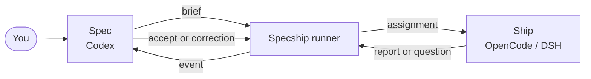

# Specship

### Plan with your best model. Build with a faster one.

**Specship turns one Codex chat into a two-model coding workflow.** Spec plans and reviews. Ship implements and tests. You stay in the conversation.

<a id="preview-status"></a>

> [!NOTE]
> **Specship is in preview.** Codex + OpenCode on Windows is the tested path. macOS setup is included but live testing is still pending. DeepSeek Harness is a preview. Install from the `redesign-beta` branch.

[](#preview-status)
[](LICENSE)
[](#requirements)
[](#requirements)
[](#ship-harnesses)

---

## Why Specship

Most coding agents use one model for everything: understanding the request, making the plan, writing the code, debugging the build, and deciding when the work is done.

Specship separates those jobs.

| | **Spec** | **Ship** |
|---|---|---|
| **Job** | Plan, decide, review, accept | Implement, test, debug, report |
| **Model** | The model in your Codex chat | A separate, usually cheaper model |
| **Works in** | Codex app or CLI | OpenCode or DeepSeek Harness |
| **You talk to** | Spec | Never directly |

You get the judgement of your strongest model where it matters, without paying for it to write every line of code. Both models use your normal accounts and limits; savings depend on the models and the task.

## What you can do

- **Start with one command.** Type `$spec` in Codex and describe the change.
- **Stay in one chat.** Spec hands Ship a short brief; Ship reports back. No copy-pasting plans between tools.
- **Wait without polling.** The runner keeps the supervisor wait open until Ship reports, asks a question, or finishes.
- **Review real work.** Spec checks the report and the actual changes before accepting.
- **Run checks independently.** Configure project checks that the runner executes after Ship reports, not commands Ship invents.
- **Keep runs recoverable.** State, decisions, checkpoints, and native sessions survive restarts.
- **Isolate edits when you want.** Worktree mode keeps Ship's changes out of your main checkout until acceptance.
- **Choose the coder.** Use OpenCode today, or the preview DeepSeek Harness adapter with native callbacks.

## How it works



1. **Plan.** Spec inspects the code and asks you about decisions that need your input.
2. **Brief.** Spec sends Ship a bounded assignment: outcome, boundaries, and acceptance.
3. **Build.** Ship implements, tests, and handles routine debugging. If it needs a consequential decision, it asks Spec and waits.
4. **Review.** Spec inspects the result, checks acceptance, and either accepts or sends a focused correction.

## Quick start

### Requirements

| Tool | Requirement |
|---|---|
| **Codex** | `0.162.0-alpha.17.2` or newer, with project skills, MCP tools, and Interrupt hooks |
| **Node.js** | Node 22 or newer; Node 24 is the tested version |
| **Git** | Required to install; recommended for the project you're changing |
| **OpenCode** | `1.18.30` or newer, signed in to your chosen Ship model |
| **DeepSeek Harness** | Optional. `0.2.1-rc.3` tested; installed desktop app with the built-in `acp` profile |

### 1. Install Specship in your project

From the root of the project you want Ship to edit:

```sh
git clone --branch redesign-beta https://github.com/notsonata/specship.git .specship/runtime
cd .specship/runtime
npm ci
npm run build
```

This keeps Specship and its dependencies inside the project:

```text
your-project/
  .specship/
    runtime/       # Specship checkout and built runner
    config.json    # Ship profiles, checks, optional limits
    runs/          # Run state, decisions, checkpoints
    artifacts/     # Retained images
  .agents/skills/  # Spec and Ship skills for Codex
  .codex/          # MCP and Interrupt hook registrations
```

Add `.specship/` to your project's `.gitignore`.

### 2. Configure Ship

Run setup from `.specship/runtime/`. Replace the executable path and model with your own.

**Windows (PowerShell)**

```powershell
node dist/cli.js setup `
  --workspace ../.. `
  --profile workhorse `
  --model openai/gpt-6-luna `
  --variant high `
  --executable "C:\path\to\opencode.exe" `
  --shell "C:\Windows\System32\cmd.exe"
```

**macOS**

```sh
node dist/cli.js setup \
  --workspace ../.. \
  --profile workhorse \
  --model openai/gpt-6-luna \
  --variant high \
  --executable "$(command -v opencode)" \
  --shell /bin/sh
```

Setup writes `.specship/config.json` and prints two pieces of Codex configuration. It does **not** edit Codex for you.

- No assignment time limit is set by default.
- Add `--max-dispatch-seconds 3600` only if you want a one-hour limit.
- Add `--isolation worktree` if you want Ship to work outside your main checkout.

### 3. Connect Codex

In your project:

1. Merge the printed `codex_toml` into `.codex/config.toml`. Keep the `direct_only_tool_namespaces` entry and the full `[mcp_servers.specship]` registration.
2. Merge the printed `hooks_json` into `.codex/hooks.json`.
3. Copy the `spec` and `ship` skills from `.specship/runtime/.agents/skills/` into `.agents/skills/`.
4. In Codex CLI, run `/hooks` and trust the generated Interrupt hook.
5. Reload the MCP connection or restart Codex.

The generated MCP block includes a long transport timeout so Spec can wait quietly. It is a transport backstop, not an assignment deadline.

### 4. Run it

Open the project in Codex, choose the model you want to plan with, and type:

```text
$spec Add pagination to the search results. Keep the existing filters working.
```

Spec handles the rest. You do not launch Ship yourself.

## Install with an AI agent

If you prefer to let an agent do the file work, give it this prompt:

```text
Install Specship for my project at <absolute project path>.

Use https://github.com/notsonata/specship and the redesign-beta branch.
Read the README. Check my OS and installed tools.
Clone into .specship/runtime, run npm ci and npm run build, then run setup.
Copy the spec and ship skills into .agents/skills.
Merge the generated Codex MCP and Interrupt hook settings without overwriting
existing settings or skills. Add .specship/ to .gitignore.
Ask me which OpenCode provider/model and effort to use.
Verify the build and configuration. Leave sign-in and hook trust to me.
```

The agent can handle files and configuration. You still sign in to your provider, trust the hook, and reload Codex.

## Ship harnesses

### OpenCode

OpenCode is the primary Ship harness.

```json
{
  "ship": {
    "default_profile": "workhorse",
    "profiles": {
      "workhorse": {
        "harness": "opencode",
        "model": "openai/gpt-6-luna",
        "executable": "C:/path/to/opencode.exe",
        "options": {
          "variant": "high",
          "shell": "C:/Windows/System32/cmd.exe"
        }
      }
    }
  },
  "limits": {
    "max_dispatch_seconds": null,
    "delivery_margin_seconds": 120
  }
}
```

- `model` uses OpenCode's `provider/model` form.
- `variant` is the reasoning effort when the model supports it.
- `profiles` lets you keep multiple Ship configurations. Ask Spec to use one by name.
- `limits` is optional; omit it or set `max_dispatch_seconds` to `null` for no assignment deadline.

### DeepSeek Harness

The preview `deepseek` harness runs Ship through the installed DSH ACP profile. It keeps a persistent session per run and uses native `ask_spec` / `report_result` tools, so decisions are not limited by DSH's 60-second MCP transport timeout.

```json
{
  "ship": {
    "default_profile": "dsh",
    "profiles": {
      "dsh": {
        "harness": "deepseek",
        "model": "deepseek-account/deepseek-flash",
        "executable": "C:/Users/you/AppData/Local/Programs/DeepSeek Harness/DeepSeek Harness.exe",
        "options": {
          "reasoning_effort": "high",
          "sandbox": "workspace-write"
        }
      }
    }
  }
}
```

Create the profile with setup:

```powershell
node dist/cli.js setup `
  --workspace ../.. `
  --harness deepseek `
  --profile dsh `
  --model deepseek-account/deepseek-flash `
  --executable "C:\path\to\DeepSeek Harness.exe" `
  --variant high `
  --sandbox workspace-write
```

On Windows, point `executable` at `DeepSeek Harness.exe`, not `dsh.cmd`. The adapter derives the bundled ACP CLI. Use the model IDs your DSH session advertises; Specship does not silently substitute a model.

To use the older MCP callback bridge instead, set `"callbacks": "mcp"`. It has the 60-second MCP ceiling and uses `needs_decision` reports rather than an in-turn wait.

## Power features

<details>
<summary><strong>Independent acceptance checks</strong></summary>

Define trusted checks in `.specship/config.json`:

```json
{
  "checks": {
    "test": {
      "command": "npm test",
      "cwd": ".",
      "timeout_ms": 120000,
      "expected_exit": 0
    }
  }
}
```

A brief can then require them:

```json
{
  "acceptance": ["pagination keeps existing filters working"],
  "acceptance_criteria": [
    { "id": "A1", "text": "filters still apply" },
    { "id": "A2", "text": "invalid page returns 400" }
  ],
  "required_checks": ["test"]
}
```

The runner executes the checks, records their results and output hashes, and refuses acceptance if a required check fails, a criterion has no evidence, or the workspace changes after the report. Check commands are trusted user configuration and run with your permissions.

</details>

<details>
<summary><strong>Worktree isolation</strong></summary>

Keep Ship's edits out of the main checkout until acceptance:

```json
{
  "ship": {
    "isolation": "worktree",
    "default_profile": "workhorse",
    "profiles": {
      "workhorse": {
        "harness": "opencode",
        "model": "openai/gpt-6-luna",
        "options": {}
      }
    }
  }
}
```

Ship runs in a detached Git worktree. Acceptance runs the checks there, applies the diff to the main workspace, and removes the worktree. If the patch conflicts, acceptance fails and the worktree stays for inspection.

Worktree mode requires a Git repository with a commit. It uses the committed `HEAD`, so uncommitted changes in the main tree are not present. It is a Git boundary, **not an OS sandbox**.

List or prune retained worktrees:

```powershell
node dist/cli.js worktrees --workspace ../..
node dist/cli.js worktrees --workspace ../.. --prune true
```

</details>

<details>
<summary><strong>Recovery and cleanup</strong></summary>

Runs are durable. If Codex or Ship disconnects, recover the existing run rather than starting over. State, decisions, checkpoints, prompt journals, and native sessions are kept under `.specship/runs/`.

Specship refuses ambiguous recovery instead of guessing. If the original Ship process is still alive, it will not steal the session. If a prompt outcome cannot be reconciled, the run fails with a concrete error.

</details>

## Safety and limits

> [!WARNING]
> **Specship is designed for trusted local projects.** Ship and its commands run under your user account. Worktree isolation keeps edits out of your main checkout; it does not prevent reading other files, using the network, or accessing credentials. If you need host isolation for an untrusted repository, run the whole workflow inside a container or VM.

- **Permissions stay with you.** Spec can reject a harness permission request, pause, or cancel, but cannot grant a new permission. Change permissions in OpenCode or DSH yourself if a run needs them.
- **Checks are trusted configuration.** A configured check command can modify the workspace. Review it like any project script.
- **Images:** OpenCode profiles accept PNG and JPEG images up to 5 MB combined. The DeepSeek ACP profile accepts no image input.
- **DSH sandbox:** `workspace-write` confines file writes for confined shell commands, with partial enforcement on Windows. It does not confine reads or network access.
- **Preview:** interfaces and configuration may change before a stable release.

## Troubleshooting

| Problem | Fix |
|---|---|
| `$spec` is not available | Reload or restart Codex after merging the MCP configuration; confirm the `spec` skill is in `.agents/skills/`. |
| MCP tools do not connect | Check the absolute paths in `.codex/config.toml`; confirm `node .specship/runtime/dist/cli.js --help` runs. |
| Spec stops waiting too early | Keep the generated `tool_timeout_sec`; do not wrap `mcp__specship` tools in code mode. |
| OpenCode is not found | Set `executable` to the absolute OpenCode path; on Windows use the actual `.exe`. |
| DeepSeek ACP is unavailable | Use an installed DSH with the `acp` profile and `DeepSeek Harness.exe` on Windows. |
| A run was interrupted | Recover the existing run by its saved identifiers; do not dispatch the same work again. |
| Worktree patch conflicts | Resolve the conflict or cancel the run; the worktree is retained for inspection. |

## Benchmarks

The repository includes a frozen SWE-bench Lite harness for comparing Codex, OpenCode, and Specship with either OpenCode or DeepSeek Harness as Ship. It separates quality from API-equivalent cost and requires an explicit `--execute` before any paid model call.

See [scripts/benchmark/README.md](scripts/benchmark/README.md) for setup, controls, preflight, and reporting.

## Development

```sh
npm ci
npm run check
```

`npm run check` typechecks, builds, and runs the test suite. It does not call a paid model.

## License

[Apache 2.0](LICENSE)
